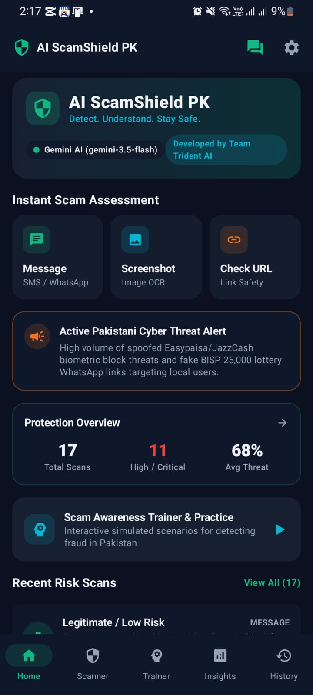
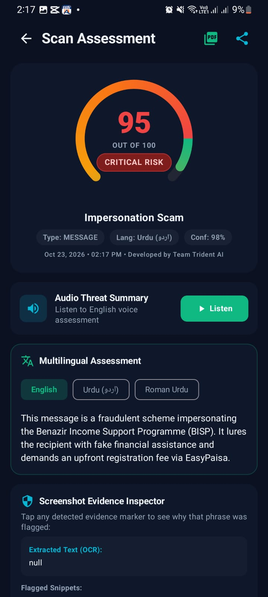

<div align="center">

# AI ScamShield PK

### AI-Powered Scam & Phishing Risk Assessment for Pakistan

**Denning Institute of Technology and Entrepreneurship (DITE), Hyderabad**  
**DITE Hackathon 2026–27 · Organised by TECHGEN**

</div>

---

## 1. Project and Team

**Project name:** AI ScamShield PK  
**Team name:** Team Trident AI  
**Institution:** Denning Institute of Technology and Entrepreneurship (DITE), Hyderabad  
**Event:** DITE Hackathon 2026–27, organised by TECHGEN

### Team members

- **Mirzadi Balouch** — Team Leader
- **Fawad Ali Soomro**
- **Mehran Ali Memon**

We are Team Trident AI, a three-member team focused on building a practical AI-powered digital-safety tool. AI ScamShield PK is our effort to make scam-awareness and suspicious-content assessment easier to access and understand for people in Pakistan.

## 2. Theme and Problem Statement

**Project theme:** AI-powered cybersecurity, digital safety, and scam awareness. If the hackathon provided an exact official theme title, replace this wording with that title.

People can receive fraudulent messages, impersonation attempts, suspicious URLs, and misleading screenshots through SMS, messaging apps, and social platforms. AI ScamShield PK helps users assess this content by presenting a risk level, explaining available warning signs, and recommending safer next steps in accessible language.

## 3. What We Built

AI ScamShield PK is an Android application that helps users assess potentially suspicious content. It combines Gemini-powered analysis with local URL-risk heuristics and fallback logic where supported. The app is designed to explain *why* content may be suspicious rather than showing only a score.

### Key features

- **Text and message analysis:** Assess submitted messages for potential scam and phishing indicators.
- **URL risk assessment:** Check URLs for structural warning signs, including IP-based hosts, punycode, suspicious subdomain patterns, URL shorteners, and possible impersonation.
- **Screenshot analysis:** Submit screenshots for AI-assisted image analysis and review available extracted text and evidence.
- **AI Scam Assistant:** Ask follow-up questions about a scan result and get help understanding warning signs.
- **Multilingual explanations:** Request explanations in English, Urdu script, or Roman Urdu.
- **Personal Scam Insights:** Review scan history, risk summaries, and activity derived from locally stored scan records.
- **Scam Awareness Trainer:** Practise evaluating simulated scam and legitimate-looking scenarios.
- **Scan history:** Revisit previous assessments stored locally using Room.
- **Exportable reports:** Generate a PDF report and share a text summary where supported.
- **Voice summary and sound feedback:** Listen to a concise English result summary and receive scan-status sounds.
- **Security FAQ and settings:** Access safety guidance and available preferences.

> **Important:** The app provides risk assessments, not guarantees. A low-risk result does not prove content is safe, and a warning alone does not prove criminal intent. Verify important requests through official channels.

## 4. How AI Is Used

### AI model / API

The app calls the **Google Gemini API** using the Gemini model identifier configured in the current source code (`gemini-3.5-flash`). Model availability and API access depend on Google's current supported models, account configuration, and API limits; verify the model ID if a request fails.

The Android project sends requests to Google's Generative Language API through **Retrofit and OkHttp**. Local heuristic analysis is also present for supported fallback workflows. The local URL analyzer uses rules and structural indicators; it should not be described as a trained machine-learning URL classifier.

### Inputs and outputs

| Input | AI / analysis process | Output |
|---|---|---|
| Text or message | Gemini analysis when configured; local fallback where supported | Risk score/severity, possible category, supporting indicators, explanation, and recommended action when available |
| URL | Local URL-structure heuristics and Gemini analysis when available | URL warning indicators and a risk assessment |
| Screenshot | Gemini multimodal image analysis when available | Image-based assessment, explanation, and extracted evidence when returned by the service |
| Follow-up question | User question plus relevant scan context | Contextual explanation or safety guidance |
| Scan history | Local database calculations, not necessarily a Gemini request | Personal activity and risk summaries |

**Fallback behavior:** When the Gemini service is unavailable or not configured, supported local analysis may still provide limited results. Local fallback is not equivalent to full Gemini-powered analysis, especially for image understanding or contextual explanations.

**Responsible use:** AI output may be incomplete or incorrect. The app should not be treated as a substitute for official security advice or independent verification.

## 5. Technology Stack

| Area | Technology |
|---|---|
| Platform | Android |
| Programming language | Kotlin |
| UI framework | Jetpack Compose |
| Design components | Material 3 |
| Navigation | Navigation Compose |
| AI service | Google Gemini API |
| Networking | Retrofit, OkHttp |
| JSON parsing | Moshi |
| Local database | Room |
| Asynchronous processing | Kotlin Coroutines |
| PDF generation | Android `PdfDocument` |
| File sharing | Android `FileProvider` |
| Text-to-speech | Android TextToSpeech |
| Sound feedback | Android ToneGenerator |
| Build system | Gradle with Kotlin DSL |

## 6. Run the Project Locally

### Requirements

- Android Studio
- A compatible JDK and Android SDK for the project's Gradle configuration
- An Android emulator or physical Android device
- A Google Gemini API key for Gemini-powered features

### Steps

1. **Download or clone the repository.**

   ```bash
   git clone https://github.com/Fawad-Soomro/Ai-Scamsheild-pk-apk
   cd Ai-Scamsheild-pk-apk
   ```

   Alternatively, download and extract the project ZIP.

2. **Open the project in Android Studio.**

   Open the folder containing `settings.gradle.kts` and allow Gradle sync to finish.

3. **Configure the Gemini API key.**

   The project includes an `.env.example` file. Create a local `.env` file in the project root and follow its format:

   ```dotenv
   GEMINI_API_KEY=YOUR_GEMINI_API_KEY
   ```

   Obtain a key through Google's official AI developer platform. Keep your real key private and **never commit `.env` or publish your key**. The repository's setup and Secrets Gradle Plugin configuration should be checked against the current project before building.

4. **Run the application.**

   Select an emulator or connect an Android device with USB debugging enabled, then press **Run** in Android Studio.

5. **Optional: build from a terminal.**

   If the Gradle wrapper is present in your local checkout:

   **Windows Command Prompt:**
   ```bat
   gradlew.bat assembleDebug
   gradlew.bat test
   ```

   **macOS/Linux:**
   ```bash
   ./gradlew assembleDebug
   ./gradlew test
   ```

   The debug APK is normally generated under `app/build/outputs/apk/debug/` after a successful debug build.

> If the Gemini model identifier, API key setup, or Gradle configuration produces an error, check the exact error message and Google's current API documentation rather than assuming the remote AI service is available.

## 7. Project Links

- **GitHub repository:** `https://github.com/Fawad-Soomro/Ai-Scamsheild-pk-apk`
- **Demo video (Google Drive):** `https://drive.google.com/file/d/1rgPdG09jCsr8KiY8PAu9M8TAoHdCR57X/view?usp=sharing`
- **Apk file (Google Drive):** `https://drive.google.com/file/d/1RhojBVn3jdCCV7eV0EKl4SnzfPThkDvg/view?usp=sharing`


For this Android application, an APK or GitHub Releases link is appropriate if a public web deployment is not available. Make sure the link is accessible to the judges and does not require them to request permission.

## 8. Screenshots

Screenshots help judges quickly understand the application. Add two clear screenshots, such as the **Home screen** and a **Scan Result screen**.


### Home Screen



### Scan Result



## 9. Datasets, Models, and Credits

- **Google Gemini API:** Used for remote AI-powered text, URL, screenshot, and contextual analysis where configured. Credit: Google. See the [Google AI for Developers documentation](https://ai.google.dev/gemini-api/docs).
- **Local URL analysis:** The supplied Android project contains a heuristic URL analyzer (`UrlRiskAnalyzer.kt`) that evaluates structural warning signs. This is project code, not a separately credited pre-trained URL-classification model.
- **Local history:** Room is used for on-device scan records and history-based insights.
- **Datasets / pre-trained model files:** No standalone external dataset or bundled pre-trained ML model file was identified in the supplied Android project ZIP.
- **Android libraries:** Kotlin, Jetpack Compose, Material 3, AndroidX, Room, Retrofit, OkHttp, Moshi, and related dependencies are declared in the project build configuration. Their authors and licences remain with their respective projects.

If the team used any additional dataset, open-source repository, icon pack, model, or other resource outside this ZIP, add its name, author/organisation, source URL, and applicable licence here.

## 10. Privacy, Security, and Limitations

- Gemini-powered features may send the content needed for the requested analysis to Google's API. Do not submit sensitive content unless you understand and accept that processing.
- Keep API keys and signing credentials out of source control.
- Review exported reports before sharing; they may contain sensitive scan details.
- Local fallback analysis has limitations and does not replace full AI analysis.
- False positives and false negatives are possible.
- The trainer uses simulated examples and is not a live threat feed.
- Risk scores are estimates, not guarantees of safety or maliciousness.

Before public distribution, verify the API-key handling, privacy disclosures, report-sharing behavior, model availability, and current platform requirements.

## 11. Acknowledgements

We thank **Denning Institute of Technology and Entrepreneurship (DITE), Hyderabad**, and **TECHGEN** for organising the **DITE Hackathon 2026–27** and providing an opportunity to develop and present a practical technology solution.

---

<div align="center">

**AI ScamShield PK**  
Built with care by **Team Trident AI**  
*Think before you click. Verify before you trust.*

</div>
